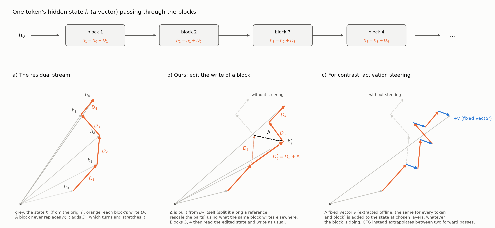
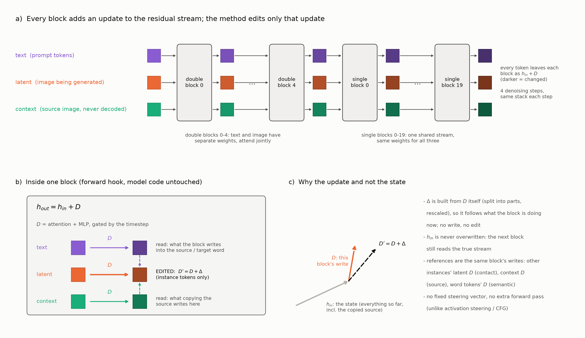
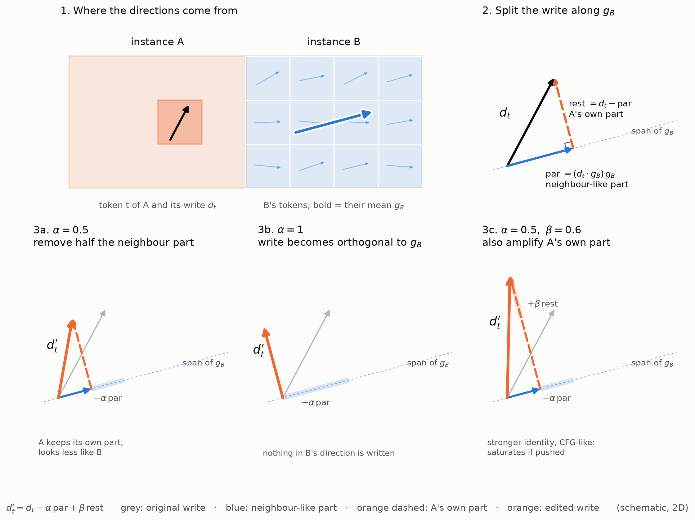
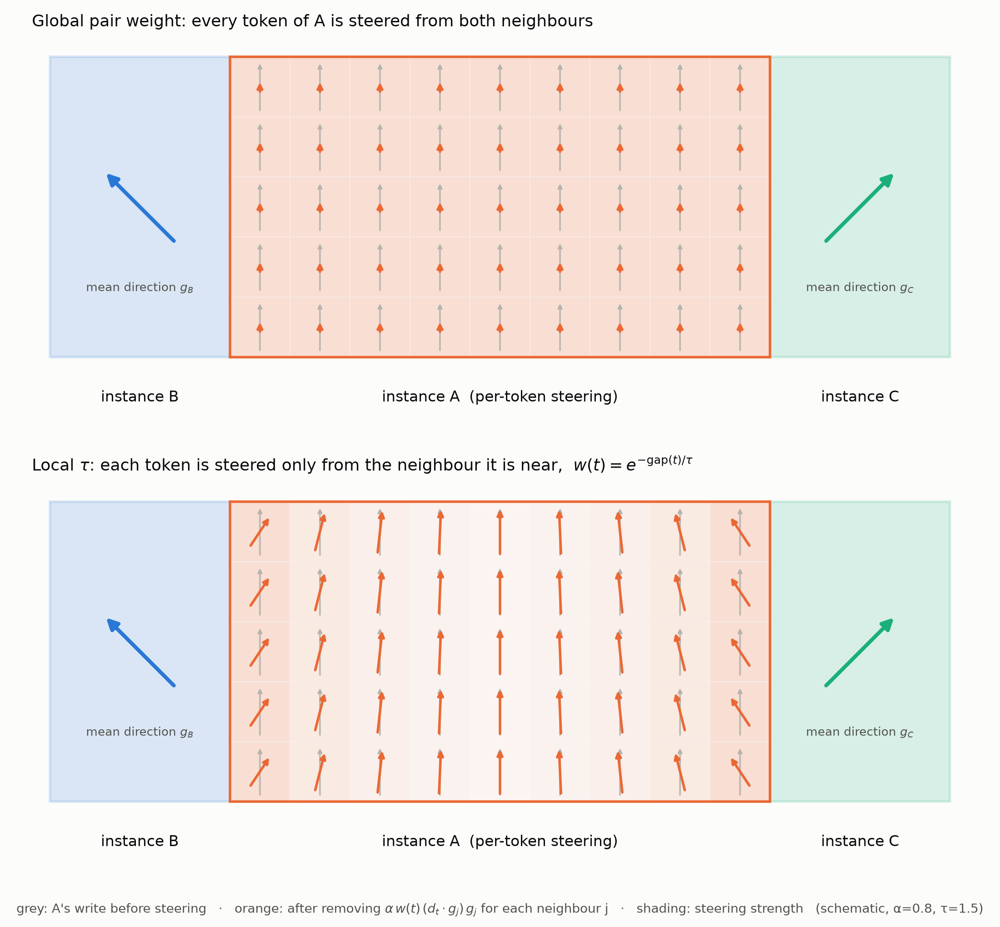
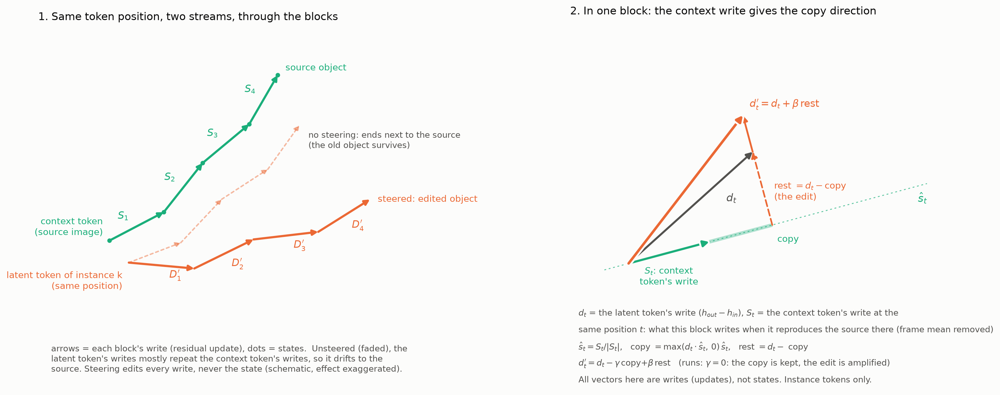
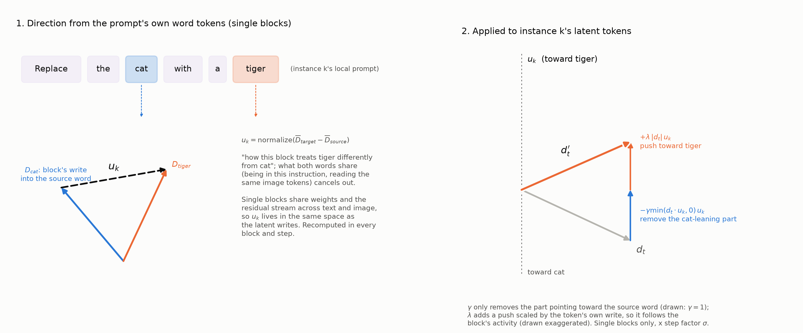

# Residual update steering for mask-free multi-instance editing

Base: MICE on FLUX.2-klein-4B (4 steps, `--free_latent --free_context`). Each instance's latent tokens are
bound to their own local prompt "Replace the {src} with {tgt}"; the source image enters as context tokens.
On top of that we add three steering terms, all acting **inside the transformer, on what each block writes**.
Code: `infer_flux2_mice_src_role.py` → `flux2/block_ortho.py` (all three terms), `flux2/block_role.py`
(per-block source strength), `flux2/sem_tokens.py` (word positions). No model or pipeline code is changed:
everything is a forward hook.

---

## 0. The common idea: steer the residual update, per modality

Follow one latent token. Its hidden state $h$ is a vector, and every block only **adds** a write to it:
$h_l = h_{l-1} + D_l$ (a). The state's direction and length change through these additions; no block
replaces it. We edit the write of a block, $D_l \to D_l + \Delta$, where $\Delta$ is computed from $D_l$
itself; the following blocks read the edited state and write as usual (b). Activation steering instead adds
a fixed, offline-extracted vector $v$ to the state, regardless of what the block writes (c).

The same picture for all tokens at once, per modality:

FLUX.2-klein has 5 double blocks (text and image have separate weights, attend jointly) and 20 single blocks
(one shared stream: text, latent and context tokens go through the same weights). Every block is a residual
update of the hidden state:

$$h_{out} = h_{in} + D,\qquad D = \text{attention} + \text{MLP (gated by the timestep)}$$

The hook reads $D = h_{out} - h_{in}$ for every token and replaces it with $D' = D + \Delta$ on the
**latent tokens of the instances only**. Text and context tokens are never modified; their writes are only
*read* as references:

| term | reference read from the same block | edits |
|---|---|---|
| contact local steering | other instances' latent writes (what the neighbour is) | latent, instance tokens near a neighbour |
| source guidance | the context token's write at the same position (what copying the source writes) | latent, instance tokens |
| semantic steering | the writes into the source / target word tokens of the instance's prompt | latent, instance tokens (single blocks) |

Why the update and not the state:

- $\Delta$ is built from $D$ itself (split $D$ into parts, rescale parts), so its size follows what the
  block is doing at that moment. A block that writes little to a token gets little steering.
- $h_{in}$ is never overwritten: the following block still reads the true residual stream.
- All references come from the current block and step: no fixed steering vector learned or extracted
  offline (unlike activation steering) and no extra forward pass (unlike CFG).

The frame mean of $D$ (the DiT's shared / massive activations) is removed before any projection and never
touched. Every strength is multiplied by the step factor $f = \sigma$ (1, .967, .908, .767), so the
terms fade as the image settles.

---

## 1. Contact local steering (against fusion / attribute leakage between neighbours)

For instance $k$ and each neighbour $j$:

- $g_j$ = normalized mean of $j$'s (frame-centred) state after the block: "what $j$ is right now".
- For each token $t$ of $k$, its write $d_t$ is split into the part along the neighbours and the rest:

$$\text{par}_t = \sum_j w_{kj}(t)\,(d_t\cdot g_j)\,g_j,\qquad \text{rest}_t = d_t - \text{par}_t$$

$$d_t' = d_t - \alpha\,\text{par}_t + \beta\,\min\!\big(1, \textstyle\sum_j w_{kj}(t)\big)\,\text{rest}_t$$

$\alpha$ removes what $k$ would copy from its neighbour, $\beta$ strengthens $k$'s own part.

**Local:** the pair weight depends on the token's own distance to the neighbour,
$w_{kj}(t) = \exp(-\max(\text{dist}_j(t) - 1, 0)/\tau_{loc})$. Only the parts of $k$ that actually touch
$j$ are steered; the inside of the object and parts far from any neighbour are left to the model, which
is what keeps the harmonization cost low compared with steering the whole instance.

Setting used: $\alpha = 0.9$, $\beta = 0.5$, $\tau_{loc} = 2$ tokens, steps 0-1. $\alpha$ in the double
blocks and singles 0-4, $\beta$ in the double blocks only.

---

## 2. Source guidance steering (against source dominance: the old object surviving)

**What goes wrong without it (left).** The context tokens are the source image on the same token grid and go
through the same blocks. Follow one position: the context token there and instance $k$'s latent token there.
Each block writes an update into both. With source dominance, the latent token's writes mostly repeat the
context token's writes ($D_l \approx S_l$), so step by step the latent token drifts to the state of the
source token and the old object survives (faded path).

**What we change (right).** In every block, the context token's write $S_t = h_{out} - h_{in}$ (frame mean
removed) is exactly "what this block writes when it reproduces the source at $t$". It is a write, not a
state: we compare the latent token's **write** with the context token's **write** in the same block, never
token values. With $\hat s_t = S_t/|S_t|$:

$$\text{copy}_t = \max(d_t\cdot\hat s_t,\,0)\,\hat s_t,\qquad \text{rest}_t = d_t - \text{copy}_t\ \text{(the edit)}$$

$$d_t' = d_t - \gamma\,\text{copy}_t + \beta\,\text{rest}_t$$

In our runs $\gamma = 0$: the copy is kept (pose, layout and lighting of the original stay in the stream) and
only the part of the write that is *not* copying is amplified. Applied in every block, the latent token's path
bends away from the source token (solid path). Instance tokens only; the background keeps copying.

Two refinements used in the reported runs (not in the figure):

- *Length preserved:* $d_t'$ is rescaled to $|d_t|$, so the write is only rotated away from copying and no
  energy is added.
- *Per block and per instance strength:* for instance $k$'s latent tokens in block $l$, own source tokens and
  own prompt tokens sit in the same softmax;
  $c_{kl} = \frac{\text{mass on own source}}{\text{mass on own source} + \text{mass on own prompt}}$,
  $s_{kl} = \min(1, c_{kl}/0.5)$, $\beta_{kl} = \beta_{lo} + s_{kl}(\beta - \beta_{lo})$. The ratio needs no
  other block or instance as a reference.

Setting used: $\beta = 0.3$ where the source competes at least as strongly as the prompt, $\beta_{lo} = 0.5$
where the prompt dominates, $\gamma = 0$, all blocks, all 4 steps, length preserved.

---

## 3. Semantic steering (single blocks: push toward the instruction)

In the single blocks text and image share the weights and the residual stream, so what a block writes into
the **word tokens** of instance $k$'s prompt is a vector in the same space as what it writes into $k$'s
latent tokens. With the source and target word positions of "Replace the **cat** with a **tiger**":

$$u_k = \text{normalize}\big(\overline{D}_{\text{target words}} - \overline{D}_{\text{source words}}\big)$$

"How this block treats *tiger* differently from *cat*." What the two words share (being in this
instruction, reading the same image tokens) cancels. On $k$'s latent tokens, with $p_t = d_t\cdot u_k$:

$$d_t' = d_t - \gamma\,\min(p_t, 0)\,u_k + \lambda\,|d_t|\,u_k$$

$\gamma$ removes only the part leaning toward the source word; $\lambda$ adds a push toward the target word,
scaled by the token's own write. Recomputed in every single block and step.

Setting used: $\gamma = 0.2$, $\lambda = 0.1$, all 20 single blocks, all steps. Note $\lambda$ adds up over
20 blocks: 0.2 is already strong, and it is the suspected source of the "toy / stock model" look (§ Results).

---

## Also on in the reported runs (not part of the three terms)

- Background anchor (`flux2/bg_anchor.py`, strength 0.5, $\tau$ = 4, margin 2 tokens): pulls the predicted
  clean background toward the source latent, zero near the instances and rising with distance.
- `--strict_masks` (overlapping masks carved so each token belongs to one instance).
- Cohesion (`--cohere`) was tried and dropped: little gain, hurt the content.

---

## Results

MICE-Bench (262 samples, same machine and seeds for all methods):

| method | local CLIP ↑ | target CLIP ↑ | bg MAE ↓ | harmonization | user study (vs MICE) |
|---|---|---|---|---|---|
| MICE (`free_latent`) | | | | | — |
| MICE (`free_latent + free_context`) | 0.2731* | 0.3047* | 15.61* | | — |
| ours (λ = 0.2) | 0.2757 | 0.3033 | 8.40 | | |
| ours (λ = 0.1, current) | | | | | |
| ours (λ = 0) | | | | | |

\* from an earlier MICE run in my notes; check which MICE variant it was before quoting.

LoMOE-Bench (64 samples):

| method | local CLIP ↑ | target CLIP ↑ | bg MAE ↓ | harmonization |
|---|---|---|---|---|
| MICE (`free_latent`) | | | | 88 |
| MICE (`free_latent + free_context`) | | | | 66 |
| ours | | | | 61 |
| ours, no semantic term | | | | |

Harmonization: higher = better (as I read 88 / 66 / 61); fill in the CLIP columns from your eval.

Ablation (one term added at a time, same subset):

| setting | local CLIP | target CLIP | bg MAE | harmonization |
|---|---|---|---|---|
| MICE base | | | | |
| + contact local steering | | | | |
| + source guidance | | | | |
| + semantic steering | | | | |

Observations so far (50-pair visual review vs MICE, MICE-Bench):

- Better: lighting and blur / focus consistency with the scene; background preserved much better (bg MAE 8.4 vs 15.6).
- About equal: novel viewpoint (both sometimes render an object in the wrong orientation for the camera).
- Worse: objects sometimes look synthetic ("toy / 3D stock model", e.g. pizza), occasional broken animal
  faces, more distorted objects. Suspected cause: the semantic push λ.
- On LoMOE we win on CLIP by a large margin but lose on the harmonization score; the detector is noisy, so
  the user study is the deciding measure.
